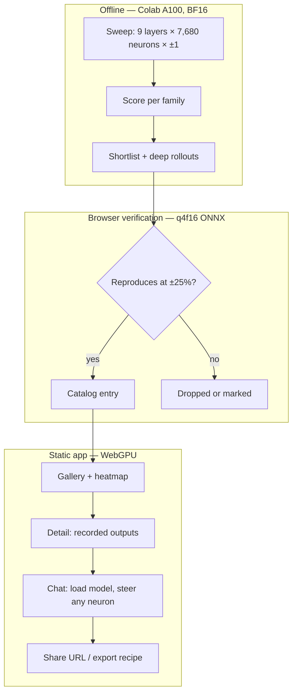
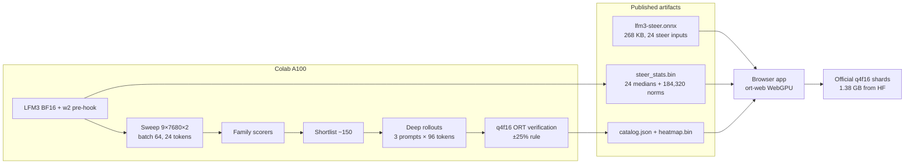

# LFM3-1.7B Neuron Playground - Plan

## Goal Capsule

- **Objective:** Anyone can open a URL, see where LFM3-1.7B's behavior-changing MLP neurons live across its three layer types, and chat with the model steered by any neuron — with no GPU, install, or server.
- **Means:** Discovery runs as a BF16 forward-hook sweep on a Colab A100 (KTD2); the app runs the official q4f16 ONNX graph in the browser with steering injected as graph inputs (KTD1, KTD5).
- **Product authority:** The project owner.
- **Open blockers:** None.
- **Execution profile:** Two pull requests — the offline pipeline, then the browser app.
- **Delivery:** Implemented and shipped by the implementing agent; no external approver.

## Product Contract

### Summary

A static browser playground for LFM3-1.7B: a catalog of browser-verified neuron recipes across five behavior families, a layer×neuron heatmap over nine sampled layers, and a chat where any neuron can be pushed up or down at any dose. The model loads only when a visitor opens a chat; the catalog works before that.

### Problem Frame

LFM3-1.7B shipped a week ago. There is a working neuron-steering culture around Qwen — neuronary's recipe dictionary, neuron-explorer's full per-neuron map, Neuron Studio's in-browser steering — and none of it covers LFM3. LFM3 also has a structure those models do not: 24 dense layers split 13 gated short convolutions, 5 sliding-window attention, 6 global attention. Nobody has mapped where behavior-changing neurons live in a hybrid stack, and the question is cheap to answer once someone sweeps it.

Playing with a 1.7B model today means a GPU, a Python environment, and a download. A browser app removes all three, and a catalog of recorded outputs puts the first valuable minute before the model finishes downloading.

### Key Decisions

- **Public, serverless playground.** Everything runs in the visitor's browser; no accounts, no storage, no server inference. (session-settled: user-directed — chosen over a personal local lab: the point is a link anyone can open). Governs R9.
- **Catalog first, chat on demand.** Visitors land on recorded results, then load the 1.38 GB model by clicking a neuron. (session-settled: user-directed — chosen over chat-first: instant value without the download). Governs R10.
- **Nine sampled layers, not all 24.** Conv 5/11/17, sliding-window 8/12/16, global attention 10/14/18, all 7,680 neurons at ±1 each. (session-settled: user-directed — chosen over the full 184,320-neuron sweep: 138,240 rollouts still settles the layer-type question at a fraction of the wall clock). Governs R2, R12.
- **Discovery on BF16 hooks; the browser uses q4f16.** NVFP4 has no browser runtime and its LFM3 path is an unmerged SGLang PR with no activation hooks, so it is only an offline transfer check. (session-settled: user-approved — chosen over NVFP4 as the runtime: no browser FP4 kernels exist). Governs R3, R14.
- **Gallery plus heatmap, one data model.** (session-settled: user-directed — chosen over gallery-only or heatmap-only: the two surfaces answer different questions off the same catalog). Governs R12.
- **Read-only sharing.** Shareable URL plus neuronary-format export; no submissions. (session-settled: user-directed — chosen over in-app submissions: that needs a backend, and neuronary already carries the community layer). Governs R13.
- **Colab A100 for the sweep.** (session-settled: user-directed — chosen over L4: 3.3 min versus 15 min wall clock for the same ~0.5 CU per sweep). Governs R2.

### Requirements

**Catalog and discovery**

- R1. The catalog covers all five families — personas, style/format, competence/safety, language switching, honesty/sycophancy — with at least one published recipe in each.
- R2. Discovery sweeps every MLP neuron in the nine sampled layers at dose +1 and −1, recording each cell's output, coherence, and family score.
- R3. Every published recipe carries a recorded steered/unsteered pair produced by the browser build, not by BF16.
- R4. A published recipe reproduces in the browser at its stated dose within ±25%, with its family's scorer still firing; failures are dropped or marked, never silently shipped.
- R5. Each family has an explicit scorer; honesty/sycophancy is scored by an LLM judge or a human pass because no lexicon covers it.
- R6. The catalog states one layer-type finding: the share of high-effect neurons by conv, sliding-window, and global-attention layer.

**Recipe semantics**

- R7. A recipe is a set of 0-indexed `(layer, neuron, dose)` triples injected at the input of `mlp.w2`, with dose normalized to the median residual norm leaving that layer on a fixed calibration corpus.
- R8. Recipes export and import in neuronary's `L{layer}N{neuron}±{dose}` format, and the catalog ships as a machine-readable recipe file.

**Browser app**

- R9. The app is a static site: all inference runs in the visitor's browser, with no server-side inference or storage.
- R10. The catalog and heatmap render before any model bytes are fetched; the model loads only when a visitor opens a chat.
- R11. Chat accepts any layer 0–23 and neuron 0–7679 at any dose in ±3, composes multiple neurons, and shows steered output against an unsteered baseline.
- R12. The heatmap shows the nine sampled layers as layer×neuron grids colored by effect score; unsampled layers appear as coverage gaps rather than missing UI.
- R13. A URL encodes the recipe, doses, and prompt state so a shared link reproduces the view; nothing is stored server-side.

**Research integrity**

- R14. The NVFP4 checkpoint is used only as an offline weight and quantization-transfer check on a Blackwell GPU; it is never the app runtime.
- R15. The sweep checkpoints per (layer, sign) so a preempted Colab session resumes without re-running completed cells.

### Key Flows

- F1. First visit — catalog and heatmap render with no model download. Covers R9, R10, R12.
- F2. Open a recipe — detail shows the recorded steered/unsteered pair and layer type; "chat with this neuron" starts the model download. Covers R3, R10, R11.
- F3. Compose — adjust doses, add neurons, compare against the unsteered baseline, then copy a link or export a recipe. Covers R11, R13, R8.
- F4. Publish — sweep, score, shortlist, re-verify in the browser, publish only what reproduces. Covers R2–R5, R15.

### Acceptance Examples

- AE1. A visitor on a laptop without WebGPU sees the catalog and heatmap, and gets an explicit unsupported message when opening chat instead of a hang. Covers R9, R10.
- AE2. A visitor steers a neuron in an unsampled layer; steering works and the panel says no recorded output exists for that cell. Covers R11, R12.
- AE3. A recipe recorded at dose 0.8 is accepted anywhere in 0.6–1.0 if its scorer still fires, and is dropped or marked unstable at 1.2. Covers R4.
- AE4. A sweep job killed after completing layers 5/11/17 resumes at layer 8 and skips the completed cells. Covers R15.
- AE5. A shared link opened in a fresh browser restores the same neurons, doses, and prompt, and produces the same family behavior. Covers R13, R7.

### Success Criteria

- 40–80 published recipes across all five families, with all three layer types represented.
- 100% of published recipes pass re-verification on the shipped q4f16 artifact at ±25%, with a fixed ten-recipe browser sample confirming the WebGPU path.
- The catalog is interactive before any model bytes are fetched.
- The layer-type finding is stated in the app with the sweep data behind it.
- Recipe export/import round-trips with neuronary's text format.

### Scope Boundaries

Deferred for later:

- The full 184,320-neuron map and catalog entries for unsampled layers.
- Steering the attention layers' sigmoid `gate_proj` — a surface Qwen models lack and a plausible second study.
- Lens readouts (R/J++/steer lenses) and neuron connection graphs.
- In-app submissions, voting, or accounts.
- An NVFP4 serving demo, if SGLang's LFM3 PR lands.
- Fine-tuning or preference training.

Outside this product's identity:

- A general-purpose LFM3 chat app or a model-quality leaderboard.
- A hosted inference service — the browser is the runtime.

### Dependencies / Assumptions

- **Browser inference is proven.** Liquid's ONNX q4f16 (1.38 GB) runs on onnxruntime-web WebGPU with ≤256-token prefill chunks; a community 0.9 GB build runs on iPhone Safari.
- **Graph-level steering is feasible but unverified.** Adding a constant-per-neuron vector before each `mlp.w2` MatMul should not break WebGPU kernels; this needs a spike before app work commits to it.
- **LFM3's MLP is `w1`/`w3`/`w2`.** `w2` is the 7680→2048 down projection, so neuron indices are 0–7679 and the Qwen recipe ports directly.
- **Colab rates are community-sourced except G4.** A100 ≈ 8.23 CU/hr; G4 = 10.05 CU/hr observed. Verify with `colab usage` at provision. A100 idles 3.4× more per hour than L4, so stop it the moment a job ends. Project total ≈ 8–15 CU of 188.
- **The sweep is minutes, not hours.** About 2,160 batched forwards at batch 64: ~3.3 min on A100, ~0.5 CU. Iteration, not the sweep, dominates the budget.
- **Never attach the `lfm3-g4` session** — it is running the owner's training job.
- **License:** LFM Open License v1.0 covers redistribution; commercial use is limited to entities under $10M annual revenue.
- **Format compatibility is a convention, not an API.** neuronary's recipe text is adopted because it is the ecosystem standard.

### Outstanding Questions

Deferred to Planning:

- Scorer thresholds per family, and which judge model for honesty/sycophancy.
- Static host for the app, distinct from the artifact repo.
- Which calibration passage to use, within KTD3's ~600-token English constraint.

### Sources / Research

- `LiquidAI/LFM3-1.7B` config and `modeling_lfm3.py`: 24 layers, hidden 2048, intermediate 7680, layer types, `w1`/`w3`/`w2` MLP. https://huggingface.co/LiquidAI/LFM3-1.7B
- `LiquidAI/LFM3-1.7B-ONNX`: 1.38 GB q4f16, WebGPU guidance, cache tensors, ≤256-token prefill chunks. https://huggingface.co/LiquidAI/LFM3-1.7B-ONNX
- `LiquidAI/LFM3-1.7B-NVFP4`: W4A4, SGLang-only, support still in PR sgl-project/sglang#46858. https://huggingface.co/LiquidAI/LFM3-1.7B-NVFP4
- `daveycodez/LFM3-1.7B-Web-ONNX`: community 0.9 GB WebGPU build with quality measurements. https://huggingface.co/daveycodez/LFM3-1.7B-Web-ONNX
- `Liquid4All/onnx-export` web tests: LFM3 graphs pass on WebGPU with per-op placement checks. https://github.com/Liquid4All/onnx-export/tree/main/tests/web
- neuronary: recipe format, dose formula, layer guidance, prior art. https://neuronary.org/about/
- neuron-explorer: per-neuron sweep pipeline and explorer for Qwen3.5-4B (MIT). https://github.com/lyramakesmusic/neuron-explorer
- Qwen3.5-4B reproduction: dose behavior, 4-bit transfer within ~2%, zero-indexed layers. https://github.com/occcat/qwen35-evil-neuron/blob/main/RESULTS.md

## Planning Contract

Product Contract preservation: unchanged, with one clarification. R3 and R4's "browser build" is read as the shipped q4f16 ONNX artifact: every published recipe is verified through ORT, and a fixed ten-recipe sample confirms the WebGPU path in Chrome before publish (KTD4, U7). The Success Criteria line carries the same sample qualifier. No R/A/F/AE ID text changed.

### Key Technical Decisions

- KTD1. **Steering is a graph input, not a runtime hook.** The modified graph adds 24 float16 inputs `steer.0`…`steer.23`, each shaped `[1,1,7680]`, and one `Add` per layer between `/model/layers.{i}/mlp/Mul/output_0` and `/model/layers.{i}/mlp/down_proj/MatMul_Q4|Q8`. The edit introduces no `Reshape` or `Shape` node, which the WebGPU op table lists as having no GPU kernel; `Add` is supported. Chosen over baked per-recipe graphs and over server-side steering (R9). Governs R9, R11.
- KTD2. **Discovery runs on HF Transformers in BF16 with a forward pre-hook on `model.model.layers[i].feed_forward.w2`.** LFM3 has no `.mlp` attribute — the ONNX export renames the module to `mlp/down_proj`, so the two surfaces are the same tensor under different names. The hook is a plain `nn.Linear` with no kernel wrapper, and identical-length prompts batch with no padding or `seq_idx`. (session-settled: user-directed — chosen over sweeping the ONNX graph: hooks give per-neuron rollouts and residual statistics from one model-agnostic pass.) Governs R2.
- KTD3. **Dose statistics ship as one binary, and the delta formula lives here.** `steer_stats.bin` holds 24 float32 layer thresholds followed by 24 × 7,680 float32 `w2` column norms; the threshold is the median residual norm leaving each layer on a fixed ~600-token English calibration passage, first token dropped. The one formula both runtimes apply is `delta = dose × threshold[layer] / ‖w2[:, neuron]‖`: add `delta` to that neuron's pre-down-projection value on every token, with the sign carried by `dose`. Computed from BF16 weights; the 4-bit app applies the same dose, and R4's ±25% absorbs the hop. Governs R4, R7.
- KTD4. **Verification runs the exact q4f16 artifact through ORT on the Colab GPU** (CUDA EP, CPU EP fallback), never the fp16 or fp32 variants — the CUDA EP has no fp32 GroupQueryAttention kernel. Governs R3, R4.
- KTD5. **The app runs the official 1.38 GB graph, not the 0.9 GB community build.** The community build trims the vocabulary to 49k, which degrades the language-switching family (R1). `externalData` streams the official shards from Hugging Face by their protobuf `location`, and `session.disable_cpu_ep_fallback` turns placement into a hard assertion. Governs R9, R10.
- KTD6. **Vite plus vanilla ES modules, no UI framework and no backend.** The heatmap is a canvas; `@huggingface/transformers` supplies only the tokenizer; Playwright drives page-level tests in headless Chromium (no WebGPU needed for layout, fetch, and click assertions). Governs R10, R12.
- KTD7. **The pipeline owns the catalog artifacts.** `catalog.json`, `heatmap.bin`, and `steer_stats.bin` are written by one unit (U4) and consumed read-only by the app. Governs R3, R8, R12.
- KTD8. **Sweep coverage is one prompt per cell, three for the shortlist.** Every cell runs one `Who are you?` prompt for 24 tokens at the stated dose; the shortlist gets three prompts at 96 tokens. This keeps the heatmap uniform and the sweep in minutes, at the cost of missing neurons that need a different prompt. Governs R2, R3.

### High-Level Technical Design

The injection point is the same tensor in both runtimes: post-activation MLP input (`silu(w1(x)) · w3(x)`) feeding the 7680→2048 down projection. In BF16 it is `feed_forward.w2`'s pre-hook argument; in the graph it is the `Add` inserted before `MatMul_Q4|Q8`.

### Assumptions

- The CUDA EP runs `MatMulNBits` for this graph; if it does not, verification falls back to the CPU EP and the run takes tens of minutes instead of seconds.
- The protobuf external-data `location` is `model_q4f16.onnx_data`; the graph builder reads it rather than assuming it.
- A100 is billed at ≈8.23 CU/hr; the first provision checks `colab usage` and aborts if the rate differs materially.
- Quantization keeps a published recipe inside ±25% of its BF16 dose; the Qwen reproduction measured ~2%.
- Hugging Face serves the 1.38 GB shard with CORS enabled and range support.
- `lfm3-g4` remains owned by the owner's training job and is never attached.

### Risks & Dependencies

- **MatMulNBits on the CUDA EP** is the verification-path risk; CPU EP fallback is slow but certain (U4).
- **WebGPU fp16 needs Chrome 121+**; browsers below that show the unsupported message (AE1), not a degraded run.
- **1.38 GB first-chat download** is the product's known barrier; the catalog is designed to be useful first (R10).
- **Colab preemption** loses only the current (layer, sign) cell block (R15).
- **A100 idle burn** — at ≈8.23 CU/hr an unattended A100 eats the project budget in about two hours, so every job runs through `colab run` and any standing session is stopped immediately (U7).
- **Live LFM3 API drift** — the graph is pinned to a commit hash of the official ONNX repo so a re-export cannot silently change node names.
- **Tokenizer weight** — the 128K-vocabulary tokenizer adds a further ~15–20 MB before first token.

## Implementation Units

### PR1: Offline pipeline

Waits on: nothing.

### U1. Steering graph and dose statistics

- **Goal:** Produce the modified ONNX graph and the dose statistics the app runs on, with proof that a zero steer changes nothing.
- **Requirements:** R7, R11, R14.
- **Dependencies:** None.
- **Files:** `tools/build_steer_graph.py`, `tools/build_stats.py`, `tools/check_nvfp4_stats.py`, `tools/tests/test_build_steer_graph.py`, `tools/tests/test_build_stats.py`, `tools/tests/test_check_nvfp4_stats.py`, `research/calibration.txt`, `web/public/lfm3-steer.onnx`, `web/public/steer_stats.bin`
- **Approach:**
  - Load the pinned `model_q4f16.onnx` without external data and locate the 24 down-projection nodes by name pattern, never by index.
  - Append one float16 input `steer.{i}` shaped `[1,1,7680]` per layer and insert `Add(down_input, steer.{i})` before each down projection.
  - Save the graph with its external-data references intact and assert the diff contains only the 24 inputs and 24 `Add` nodes.
  - Compute the per-layer residual medians and `w2` column norms from the BF16 checkpoint and write `steer_stats.bin` in the KTD3 layout.
  - Run the R14 transfer check in weight space: dequantize the NVFP4 `w2` weights, recompute their column norms, and write the per-layer delta against BF16 into the report. No NVFP4 kernel executes, so no Blackwell device is needed.
- **Technical design:** Directional only — the builder is a pure function from the pinned graph to the steered graph: locate the 24 down-projection nodes, append one input and one `Add` per layer, rewire only the down-projection inputs, and leave every other node and initializer untouched. The stats builder takes the calibration text and the BF16 model and returns the 24 medians plus the 24 × 7,680 column norms.
- **Patterns to follow:** The export's own node naming (`/model/layers.{i}/mlp/...`), which stays stable across layers and quantization mixtures.
- **Test scenarios:**
  - After the edit, the graph has exactly 24 more inputs and 24 more `Add` nodes, and every pre-existing node name and connection except the 24 rewired inputs is unchanged.
  - Zero steer on a fixed prompt produces logits equal to the unmodified graph within float16 tolerance.
  - A nonzero steer on layer 11 changes layer 11's output path and leaves layer 10's outputs bit-identical.
  - The graph contains no new `Reshape` or `Shape` node.
  - `steer_stats.bin` is `24 × 4 + 24 × 7680 × 4` bytes, every median is positive, and every column norm is finite and nonzero.
  - A truncated or mis-sized stats file is rejected at load time.
  - The NVFP4 check reports a column-norm delta under 5% for each of the nine sampled layers; a dequantization failure is reported as a blocker, never as a silent skip.
- **Verification:** `onnx.checker` passes; an ORT session loads the graph with `externalData` and runs one token; the zero-steer equality test passes on the A100.

### U8. WebGPU graph-viability gate

- **Goal:** Prove the edited graph runs entirely on WebGPU before the sweep's catalog is validated, so a failed edit does not invalidate GPU hours.
- **Requirements:** R9, R11.
- **Dependencies:** U1.
- **Files:** `tools/webgpu_check/index.html`, `tools/webgpu_check/README.md`
- **Approach:**
  - Load the modified graph with `externalData` and `session.disable_cpu_ep_fallback`; a node left on the CPU must abort session creation.
  - Run the same prompt unsteered and steered, compare against the unmodified graph, and assert that a nonzero dose changes the output.
  - Run in Chrome 121+ on a GPU-capable machine: the lab has no GPU-backed browser, so this is a manual owner-run gate.
- **Execution note:** Gate, not a demo. A failure stops the run and reopens KTD1 before U2 spend.
- **Test scenarios:**
  - The page loads with `disable_cpu_ep_fallback` and reports no fallback error.
  - The session lists 24 steer inputs beside the original 50.
  - Zero steer produces the same output as the unmodified graph.
  - A +1 dose on one layer changes the output; a dose on a different layer leaves the first unchanged.
  - A browser without WebGPU shows the unsupported message instead of a crash.
- **Verification:** The gate page reports PASS on all five checks in Chrome 121+.

### U2. Sweep harness with batched per-row injection

- **Goal:** Run 138,240 rollouts on the A100 with resumable per-(layer, sign) checkpoints.
- **Requirements:** R2, R15 (F4).
- **Dependencies:** U1, U8.
- **Files:** `research/sweep.py`, `research/inject.py`, `research/prompts.json`, `research/tests/test_inject.py`, `research/tests/test_resume.py`
- **Approach:**
  - Load LFM3 in BF16 on the A100 and register one forward pre-hook on each `feed_forward.w2` (KTD2).
  - Replicate one prompt 64 times per batch; each row injects a different neuron at a per-row delta derived from the KTD3 stats.
  - Write one JSONL record per cell, then mark `(layer, sign)` complete only after its records flush.
  - Skip any `(layer, sign)` already marked complete on start.
- **Execution note:** Prove single-cell equivalence first: the batched row must match a batch-of-one run for the same neuron before any full sweep.
- **Test scenarios:**
  - The hook adds exactly the delta at the target row and neuron and leaves every other row and neuron unchanged.
  - Two rows with different neurons and signs in one batch produce independent results.
  - A batch-of-one run and the corresponding row of a batch-of-64 run agree within bf16 tolerance.
  - A resumed run skips a completed `(layer, sign)` and continues at the next one (covers AE4).
  - A run killed mid-layer leaves the completed records readable and the layer marked incomplete.
- **Verification:** A one-layer sweep at `--layers 5 --signs +1` completes, and its record count equals 7,680.

### U3. Family scoring and shortlist

- **Goal:** Rank every swept cell by family effect and produce a balanced shortlist and deep rollouts.
- **Requirements:** R2, R5 (F4).
- **Dependencies:** U2.
- **Files:** `research/score.py`, `research/shortlist.py`, `research/families/personas.json`, `research/families/style.json`, `research/families/competence.json`, `research/families/language.json`, `research/families/honesty.json`, `research/tests/test_score.py`
- **Approach:**
  - Lexicon and regex scorers for personas, style, and language; tool-call and refusal pattern checks for competence; an LLM-judge call or a recorded human pass for honesty.
  - Normalize each family's score against its own unsteered baseline and random-neuron controls.
  - Cap the shortlist per family while keeping all three layer types represented.
- **Test scenarios:**
  - A hostile sample scores above the neutral baseline for the persona family; a neutral sample stays low.
  - A looping output raises the repetition flag.
  - A Chinese answer is detected as a language switch for the language family.
  - The honesty scorer returns abstain when no judge is configured instead of guessing.
  - The shortlist keeps at least one unit from each layer type when candidates exist.
- **Verification:** Scoring the recorded baseline prompt yields a near-zero effect for every family.

### U4. q4f16 verification and catalog build

- **Goal:** Publish only recipes that reproduce on the shipped graph, and emit the three app artifacts.
- **Requirements:** R1, R3, R4, R6, R8 (F4).
- **Dependencies:** U1, U3, U8.
- **Files:** `research/verify.py`, `research/build_catalog.py`, `research/tests/test_catalog.py`, `web/public/catalog.json`, `web/public/heatmap.bin`, `catalog/recipes.json`
- **Approach:**
  - Load the modified q4f16 graph through ORT with the CUDA EP and feed the steer inputs from the stats file.
  - Re-run each shortlisted recipe at its stated dose and again at ±25%, and keep it only when the family scorer still fires.
  - Emit `catalog.json` with recorded steered/unsteered pairs, layer type, dose, and scorer result; emit `heatmap.bin` as one int8 score per cell over the nine layers plus a 24-entry layer manifest; compute the layer-type share.
  - Serialize recipes in neuronary's text format alongside the JSON.
- **Test scenarios:**
  - A recipe whose effect disappears at 0.75 of its dose is rejected (covers AE3).
  - A recipe that stays inside ±25% and keeps its scorer firing is accepted (covers AE3).
  - A NaN or empty output is rejected regardless of score.
  - The catalog contains all five families and all three layer types.
  - `heatmap.bin` is 9 × 7,680 bytes and the layer manifest lists all 24 layers with the 15 unsampled ones flagged.
  - A recipe string round-trips through the neuronary parser unchanged.
- **Verification:** Catalog counts are within 40–80, and the verification report lists zero accepted recipes without a recorded output pair.

### PR2: Browser app

Waits on: PR1 (merge order only — the app reads the pipeline's artifacts).

### U5. App shell, gallery, heatmap, URL state

- **Goal:** The catalog is useful before any model byte is fetched.
- **Requirements:** R6, R8, R10, R12, R13 (F1, F2, F3).
- **Dependencies:** U4's artifacts.
- **Files:** `web/index.html`, `web/vite.config.js`, `web/src/main.js`, `web/src/catalog.js`, `web/src/heatmap.js`, `web/src/state.js`, `web/src/recipe-format.js`, `web/tests/catalog.test.js`, `web/tests/state.test.js`, `web/tests/recipe-format.test.js`, `web/tests/pages.spec.js`
- **Approach:**
  - Gallery cards render recipe, family, layer type, dose, and the recorded steered/unsteered pair.
  - Heatmap draws a 24-row × 7,680 canvas from `heatmap.bin` and the layer manifest: nine rows carry scores and the other 15 render as explicit gap rows.
  - A finding panel states the share of high-effect neurons per layer type with the sweep counts behind it.
  - Recipe text imports into and exports from URL state in neuronary's format.
  - URL state encodes recipes, doses, and prompt; no network call to model weights occurs on load.
- **Test scenarios:**
  - Loading the page issues no request for the model graph or shards.
  - Family and layer-type filters narrow the gallery consistently.
  - A URL with two neurons at different doses round-trips to the same state (covers AE5).
  - Clicking a gap row shows the coverage notice rather than an empty detail (covers AE2).
  - The layer-type panel reports a share for each of the three types and the cell counts behind them.
  - A neuronary string imports into URL state and exports back unchanged.
  - A 390 px viewport keeps the gallery readable and the heatmap scrollable.
- **Verification:** `npm --prefix web test` passes and the gallery renders from the committed artifacts.

### U6. Chat, steering runtime, and model loading

- **Goal:** Load the graph on demand and run steered against unsteered chat.
- **Requirements:** R9, R10, R11, R13 (F2, F3).
- **Dependencies:** U1's graph and stats, U5's routing.
- **Files:** `web/src/chat.js`, `web/src/onnx.js`, `web/src/steer.js`, `web/src/tokenizer.js`, `web/tests/steer.test.js`, `web/tests/cache.test.js`
- **Approach:**
  - Create the session with `executionProviders: ['webgpu']`, `externalData` pointing at the official shards, and `session.disable_cpu_ep_fallback`.
  - Compute each steer input from the recipe, the layer threshold, and the column norm, then feed 24 float16 tensors every step.
  - Manage the graph's actual cache inventory: 13 `past_conv.N` states and 11 key/value pairs (attention layers 2/4/6/8/10/12/14/16/18/20/22); prefill in chunks of at most 256 tokens; decode one token per step.
  - Run the unsteered baseline first, then the steered pass, in the same session.
- **Execution note:** U8 is the gate for this unit; do not wire the chat UI until it passes.
- **Test scenarios:**
  - The delta for a known layer, neuron, and dose matches KTD3's formula.
  - Zero dose produces output identical to the baseline pass.
  - The session exposes 13 conv-state inputs and 11 key/value pairs, matching the graph's input list.
  - Cache shapes advance by exactly one sequence position per decode step.
  - A 600-token prompt is split into 256-token prefill chunks and produces the same first token as a single-chunk run.
  - A browser without WebGPU shows the unsupported message (covers AE1).
  - Each of the 24 steer tensors is float16 and shaped `[1,1,7680]`.
- **Verification:** In Chrome 121+, a steered chat completes and differs from the baseline at a nonzero dose; the console shows no CPU-fallback error.

### U7. Publish artifacts and deploy the static app

- **Goal:** The URL a visitor opens serves the app and the five catalog artifacts.
- **Requirements:** R9, R10 (F1).
- **Dependencies:** U4, U6.
- **Files:** `scripts/publish_artifacts.py`, `web/README.md`
- **Approach:**
  - Upload `lfm3-steer.onnx`, `steer_stats.bin`, `catalog.json`, `heatmap.bin`, and `catalog/recipes.json` to the project's Hugging Face repo with a pinned revision.
  - Point the app at those URLs and at the pinned official shard revision; document the license notice and the deploy step.
  - Before publishing, re-run a fixed ten-recipe browser sample in Chrome 121+ against the recorded outputs and the ±25% rule.
  - Put the spend guard in the runbook: every GPU job uses `colab run` so the VM self-releases, and any standing session is stopped the moment its job ends.
- **Test scenarios:**
  - A dry run lists exactly the five artifacts and their checksums.
  - The built app resolves every artifact URL and fails loudly on a 404.
  - The browser sample covers all three layer types and at least three families, and its report is published with the catalog.
  - The page shows the LFM Open License attribution.
- **Verification:** A cold browser load fetches the catalog first, then the graph and shards only after a chat is opened; the ten-recipe sample passes.

## Verification Contract

| Command | Proves | Units |
|---|---|---|
| `uv run pytest tools/tests research/tests -q` | Graph edit, stats layout, NVFP4 delta, injection, resume, scoring, catalog rules | U1–U4 |
| `colab run --gpu A100 tools/check_nvfp4_stats.py` | Column-norm delta against the NVFP4 weights | U1 |
| `npm --prefix web test` | URL state, filters, recipe format, delta math, cache shapes | U5, U6 |
| `npm --prefix web run test:e2e` | No model fetch on load, gap-row notice, finding panel, 390 px layout | U5 |
| `npm --prefix web run build` | The static app builds with the committed artifacts | U5, U6 |
| `colab run --gpu A100 research/sweep.py --layers 5 --signs +1` | One layer sweeps 7,680 cells end to end | U2 |
| `colab run --gpu A100 research/verify.py --limit 5` | The q4f16 graph loads and reproduces a dose | U4 |
| Manual: `tools/webgpu_check/index.html` in Chrome 121+ | Graph loads with no CPU fallback; zero steer matches; a dose changes output | U8 |
| Manual: ten-recipe browser sample before publish | The WebGPU path reproduces published doses | U7 |

## Definition of Done

- 40–80 recipes published across all five families and all three layer types, each with a recorded steered/unsteered pair from the q4f16 graph.
- Every published recipe passes the ±25% rule, and the verification report accounts for every rejected candidate.
- A fixed ten-recipe browser sample reproduces at its stated dose in Chrome 121+ before publish.
- `catalog.json`, `heatmap.bin`, `steer_stats.bin`, `lfm3-steer.onnx`, and `catalog/recipes.json` are published at a pinned revision and referenced by the app.
- The catalog and heatmap are interactive before any model bytes are fetched; chat loads on demand and runs steered against baseline.
- The layer-type finding appears in the app with the sweep numbers behind it.
- Recipe export and import round-trip in neuronary's format.
- Every GPU job released its VM or was stopped at the end; no A100 was left idle.
- Abandoned spike code is removed; the U8 gate page stays as a repeatable check, and `web/README.md` covers the artifact URLs, the pinned revisions, and the deploy step.
